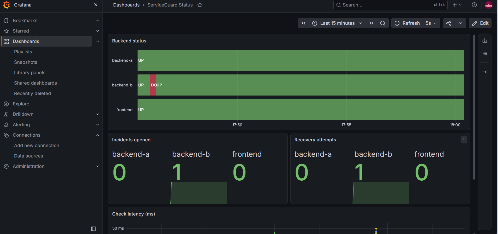
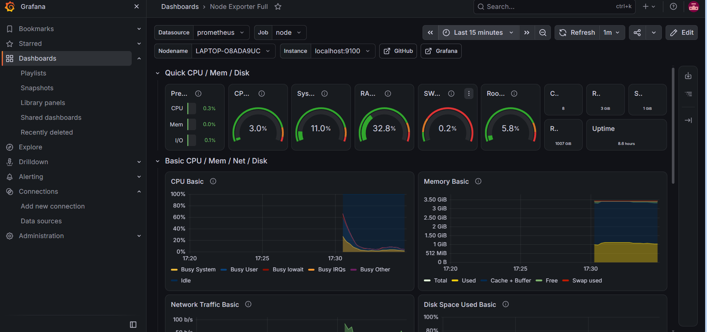

# ServiceGuard


A Python tool that monitors a small load-balanced web stack on Linux, detects
failures per component, logs incidents, and attempts controlled recovery.
Built and tested on Ubuntu 24.04 under WSL 2 as a learning project covering
Linux, Python, HTTP checks, systemd, Nginx, logging, incident handling and
basic Prometheus/Grafana monitoring.

## What it does

1. **Test stack:** Nginx load balancer (port 8080) in front of two Python
   backends (9001, 9002). All three run as systemd services.
2. **Checks** the frontend and each backend separately (status code and page
   content), driven by `config.json`.
3. **Detects** failure after N consecutive failed checks and opens an incident
   that names the failed target.
4. **Logs** incidents as JSON (`logs/incidents.jsonl`) and readable text.
5. **Recovers** (`--recover`): restarts only the failed service. Nginx gets
   `nginx -t` first. Services must be on an allow-list. Recovery is confirmed
   by the next HTTP check, and attempts are capped before escalating.
6. **Runs as a systemd service** (`Restart=on-failure`).
7. **Exposes metrics** on `127.0.0.1:9101/metrics`. Prometheus scrapes it, and
   Grafana shows backend status, incident counts and latency.

## Architecture

See [docs/ARCHITECTURE.md](docs/ARCHITECTURE.md) for diagrams.

```text
Windows 11 -> WSL 2 (Ubuntu 24.04, systemd)
  Nginx :8080 -> backend-a :9001, backend-b :9002
  ServiceGuard -> checks all three, restarts failed ones, logs, metrics :9101
  Prometheus :9090 scrapes ServiceGuard and Node Exporter :9100
  Grafana :3000 reads Prometheus
```

## Project layout

```text
src/         checker.py, recovery.py, serviceguard.py, metrics.py, backend.py
config.json  targets, thresholds, intervals
tests/       pytest tests (8)
scripts/     summarize_incidents.py
testsite/    Nginx config, systemd units, example sudoers rule
monitoring/  prometheus.yml
evidence/    raw logs from each failure test
docs/        ARCHITECTURE, TEST_RESULTS, TROUBLESHOOTING
.github/     CI workflow (runs pytest on every push)
```

## Setup (Ubuntu 24.04 / WSL 2 with systemd)

```bash
sudo apt update
sudo apt install -y python3-pip python3-venv nginx curl prometheus prometheus-node-exporter
git clone https://github.com/Sanjanatej/serviceguard.git && cd serviceguard
python3 -m venv .venv && source .venv/bin/activate
pip install -r requirements.txt

# Nginx load balancer
sudo cp testsite/nginx-testsite.conf /etc/nginx/sites-available/testsite
sudo ln -sf /etc/nginx/sites-available/testsite /etc/nginx/sites-enabled/testsite
sudo nginx -t && sudo systemctl reload nginx
```

Edit `User=` and the paths in `testsite/systemd/*.service` and the username in
`testsite/sudoers-serviceguard.example` to match your machine, then:

```bash
sudo cp testsite/systemd/*.service /etc/systemd/system/
sudo cp testsite/sudoers-serviceguard.example /etc/sudoers.d/serviceguard
sudo chmod 440 /etc/sudoers.d/serviceguard && sudo visudo -cf /etc/sudoers.d/serviceguard
sudo systemctl daemon-reload
sudo systemctl enable --now sg-backend-a sg-backend-b serviceguard
sudo cp monitoring/prometheus.yml /etc/prometheus/prometheus.yml
sudo systemctl restart prometheus
```

Grafana is installed separately from Grafana's own APT repository. Add
Prometheus (`http://localhost:9090`) as a data source.

## Usage

```bash
python src/serviceguard.py --once        # one check of all targets, exit 0 or 1
python src/serviceguard.py --recover     # monitor and recover
python -m pytest tests/ -v               # tests
```

## Test results

Details: [docs/TEST_RESULTS.md](docs/TEST_RESULTS.md). All figures come from
single runs on one machine.

| Scenario | Result |
|---|---|
| Nginx stopped (v1, single Nginx) | Restarted automatically, ~6.5s detected downtime |
| Broken Nginx config (v1) | Refused to restart onto bad config, escalated |
| Missing health file (v1) | Restart ran but could not fix it, escalated |
| One backend stopped (v2) | Nginx kept serving: 10 of 10 requests returned 200 |
| Backend stopped, ServiceGuard v2 | Incident named the backend, restarted only it, ~9s |
| ServiceGuard killed with SIGKILL | systemd restarted it |

## Limitations

- One machine, one run per scenario: demonstrations, not statistics.
- Not a cloud or multi-node deployment. No alerting (no Alertmanager).
- The backends are simple Python test servers.
- Metric counters reset when ServiceGuard restarts.
- The per-cycle summary line shows the status from before recovery ran.
- If both backends die, the frontend also fails and restarting Nginx cannot fix it.
- Recovery pauses the monitor loop briefly, because checks run in sequence.
- Not tested: restart after a full WSL shutdown.
- The Node Exporter dashboard is a community dashboard (Grafana ID 1860).

## Screenshots

ServiceGuard Status dashboard: `backend-b` goes DOWN briefly while `backend-a`
and the frontend stay UP, then the incident and the recovery attempt are counted.



Node Exporter dashboard (community dashboard, Grafana ID 1860) showing CPU,
memory, disk and network for the WSL machine.


