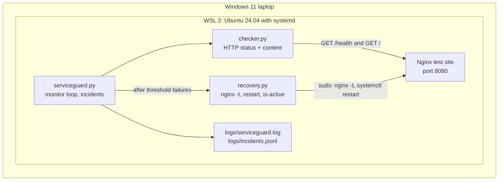
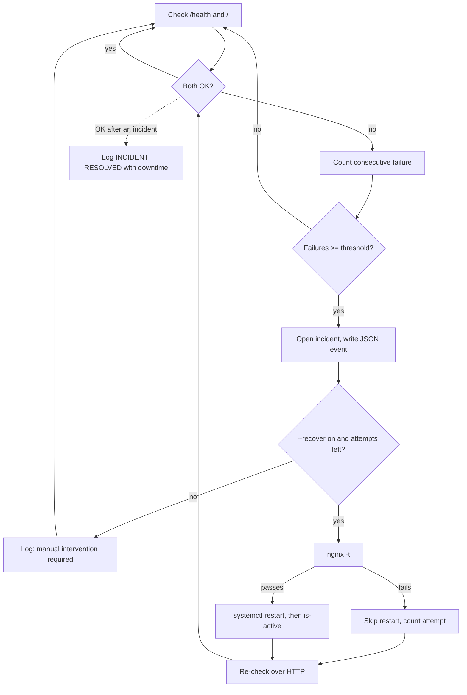

# ServiceGuard Architecture

## Components

## Incident lifecycle

## Notes

- Everything runs on one local machine. There is no cloud component.
- Recovery is verified by a fresh HTTP check, not by the restart result.
- The sudoers rule allows only `nginx -t` and `systemctl restart nginx`.
