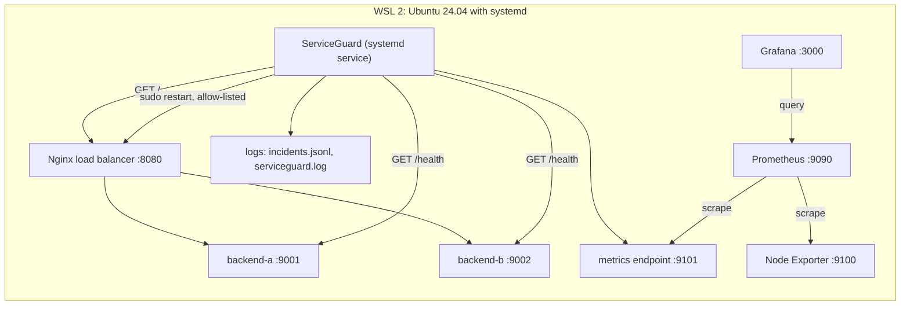
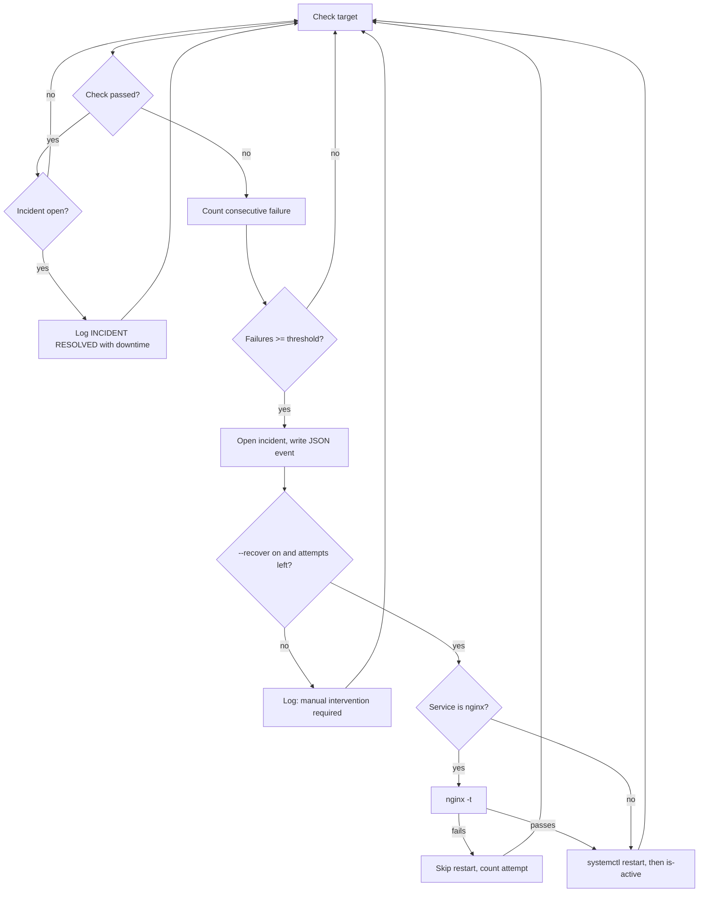

# ServiceGuard Architecture

## Components

## Per-target incident lifecycle

Each target (frontend, backend-a, backend-b) has its own failure counter and
incident state.

## Notes

- Everything runs on one local machine. There is no cloud component.
- Recovery is confirmed by the next HTTP check, not by the restart command.
- The sudoers rule allows only `nginx -t` and restarts of nginx, sg-backend-a
  and sg-backend-b. The code also keeps its own allow-list.
- systemd watches ServiceGuard (`Restart=on-failure`). ServiceGuard watches
  the web services.
